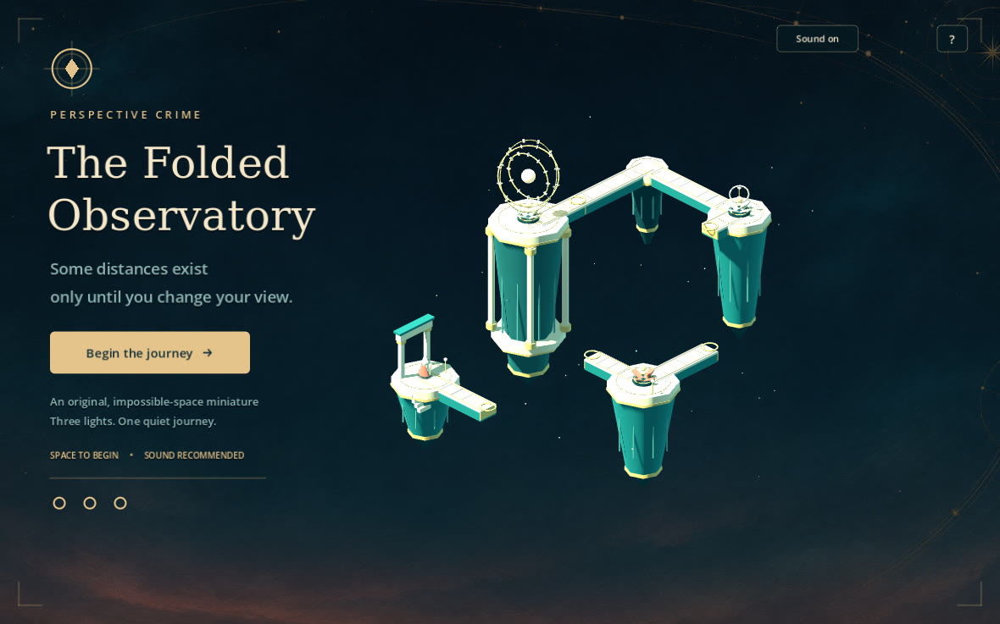
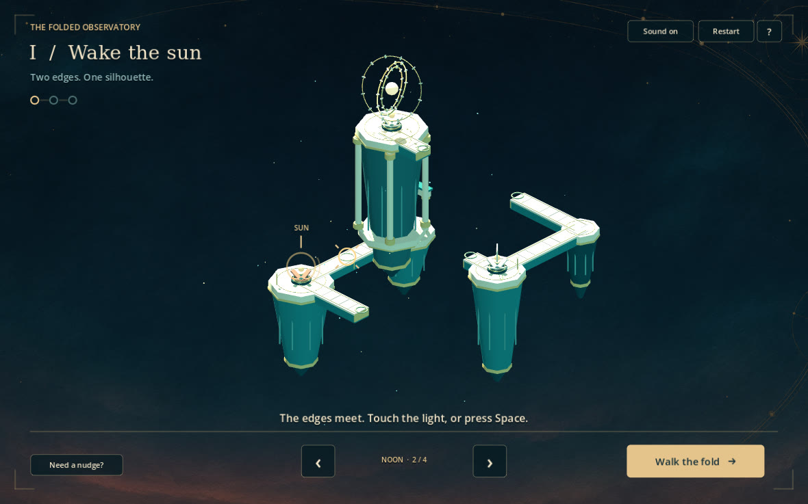
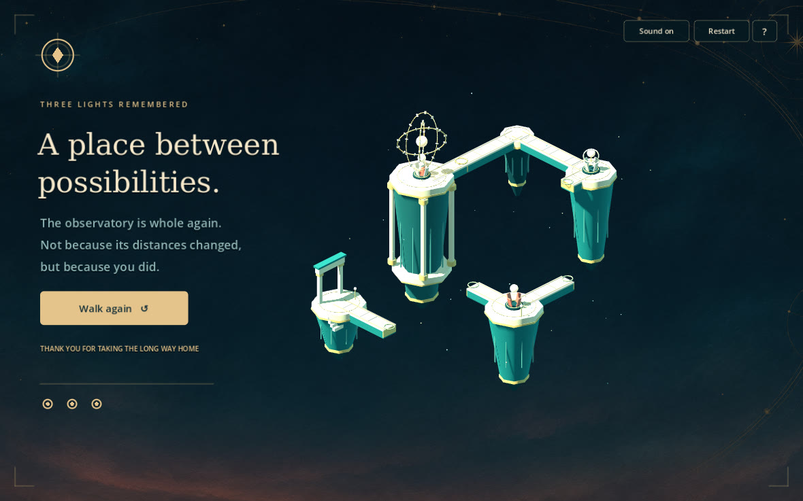

# Verification and delivery

## Actual environments

- Godot **4.6.3 stable (7d41c59c4)**, Linux x86_64, Debian 13.
- Graphical playtest: Compatibility renderer, Mesa llvmpipe / OpenGL 4.5 software rendering on the cloud Linux desktop.
- The desktop lacks a physical audio output device. Manual testing used Dummy audio. Audio mixing is captured in the movie, but speaker/headphone playback and subjective listening are not claimed.
- Windows packages are cross-exported. **Windows runtime has not been tested.** No claim of hardware-GPU performance, mobile/touch support, controller support, or public release certification.

## Automated verification

Headless import and the mechanism/input/flow suite pass on 4.6.3: **81 checks, zero failures**. Final test output has no script errors or cleanup warnings. This covers:

- Three real orthographic projection coincidences and incorrect-view separation.
- Offscreen, out-of-frustum, and behind-camera rejection.
- The avatar changes depth continuously across a fold with unchanged projected position.
- Invalid traversal, repeated activation and input guards.
- Help modal and keyboard control behavior, hint and mute state.
- Reset during rotation and traversal, reset after completion, and a second full journey.

## Graphical playtesting

A manual desktop playthrough used normal game input, not test callbacks: mouse Begin, wrong-view Space rejection, successive E/Space alignment and walking through all three shrines, visible ending, Space replay, contextual H hint, help open/close, blocked orbit while help is open, mute indicator and reset during orbit. Repeated Space did not skip stages or start duplicate walks.

Visual review prompted two improvements: reduced key/fill/ambient light to retain the ivory/teal palette, and moved the decorative summit support away from the first fold's viewing ray. Both changes were retested by the automated suite. The final rendered demonstration uses the same game methods and captures its own title, play views and ending.

The software display driver logs an unsupported V-Sync-mode warning. Rendering and play work; this is not a script failure. Frame timing on this software-rendered cloud desktop is not representative of a hardware GPU.

## Scope and honest limits

This is a short authored puzzle with three folds in a single composition and four discrete views. It is not a long campaign or free-roaming platformer. The character follows constrained routes and projection-null topology transitions, rather than physics bridges. Gold ring overlays deliberately remain visible through geometry. No runtime AI/network service is present. Builds are unsigned. PR remains draft for human review; no merge or deployment.

## Packaged build and video

Both Linux x86_64 and Windows x86_64 release exports were produced with official Godot 4.6.3 templates, verified against the official template archive SHA-512. ZIP CRC and packaged-file hashes were checked. The extracted Linux executable completed its full headless demo with `DEMO_COMPLETE folds=3 turns=4` and exit 0, then was launched graphically on the Linux desktop. It contains the same final game code and assets used for the rendered video.

The captured demonstration is **39.93 seconds**, **1280×800**, **30 fps**, H.264 video with **48 kHz AAC** game audio. It is an actual Godot Movie Maker rendering of the full opening-to-ending sequence, subsequently transcoded to MP4. Audio is non-silent and remains below full-scale. It was not made from generated gameplay images. The movie uses deterministic game input; the manual control checks above were a separate run.

Actual game screenshots (JPEG encoding only; no layout/content retouching):

